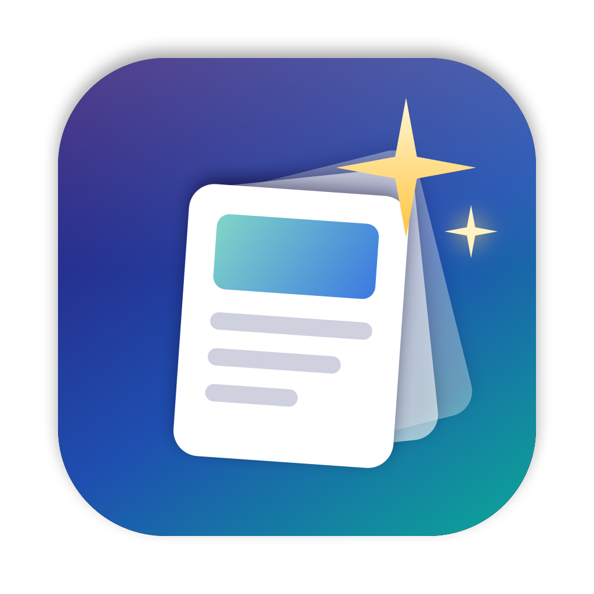
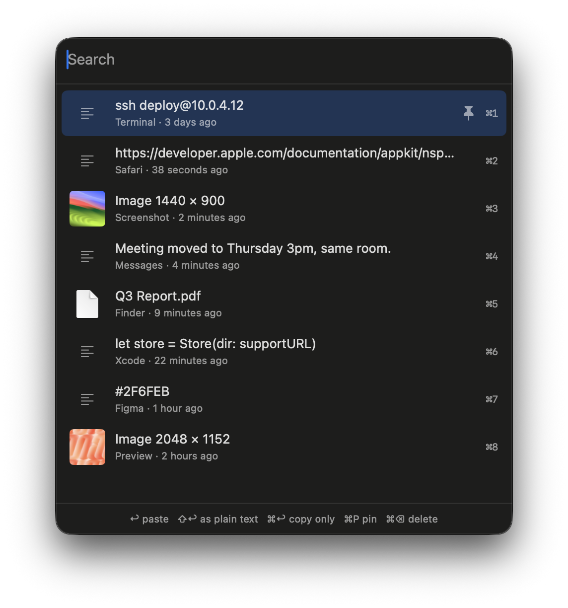

<p align="center"></p>

# Magpie

A small clipboard history for macOS. It remembers what you copy (text, screenshots, images, files) and lets you paste any of it back with a couple of keystrokes.

It's native Swift with no dependencies, no account, no sync and no telemetry. Your history stays in a folder on your Mac.

<p align="center"></p>

## How it works

1. Copy things the way you normally do: ⌘C, ⌃⇧⌘4 screenshots, files in Finder.
2. Press **⌥⌘V** anywhere. A panel opens at your cursor.
3. Type to filter, pick with the arrow keys, and press **Enter**. The item is pasted into the app you were in.

| Key | Action |
| --- | --- |
| ⌥⌘V | Open or close the history |
| ↩ | Paste |
| ⇧↩ | Paste as plain text |
| ⌘↩ | Copy only, don't paste |
| ⌘1 – ⌘9 | Paste one of the first nine items |
| ⌘P | Pin or unpin |
| ⌘⌫ | Delete |
| Esc | Close |

Clicking an item pastes it too. Opening Magpie from Spotlight also shows the history.

## What it keeps

- Text, with its formatting (RTF) when the source app provides it
- Images and screenshots, stored as PNG
- Files and folders copied in Finder (it stores their paths, not copies of the files)

Copying something that's already in the history moves it back to the top instead of adding a duplicate.

By default, history holds the last **500** items or **30 days**, whichever runs out first, and images are capped at **300 MB** in total. You can change the item count from the menu bar icon under **Keep Last** (25 to 1,000). Pinned items are never removed automatically and don't count toward the limit.

## Privacy

- Copies marked as concealed or transient by password managers (1Password, Bitwarden, Keychain Access, and others that follow [nspasteboard.org](http://nspasteboard.org)) are never recorded.
- From the menu bar icon you can choose **Ignore Copies from [app]** for any app.
- Everything is stored in `~/Library/Application Support/Magpie/`: an `items.json` index and a file for each image or rich-text item. Delete that folder to wipe the history.

## Install

You need Xcode 16 or later and [XcodeGen](https://github.com/yonaskolb/XcodeGen) (`brew install xcodegen`).

1. Clone the repo.
2. In `project.yml`, set `DEVELOPMENT_TEAM` to your own Apple team ID and `PRODUCT_BUNDLE_IDENTIFIER` to your own bundle ID.
3. Run:

   ```sh
   ./install.sh
   ```

   This builds a Release copy, puts it in `/Applications`, and launches it.

The first time you press Enter to paste, macOS asks you to grant Magpie **Accessibility** access (System Settings → Privacy & Security → Accessibility). Magpie needs this to send ⌘V to the app you're in. Until you allow it, Enter copies the item and you paste it yourself.

To start Magpie automatically, choose **Launch at Login** from the menu bar icon.

## Development

```sh
xcodegen generate
open Magpie.xcodeproj
```

Run the tests with:

```sh
xcodebuild -project Magpie.xcodeproj -scheme Magpie test
```

| File | What it does |
| --- | --- |
| `Sources/Store.swift` | The history: adding, de-duplicating, pinning, size limits, saving to disk |
| `Sources/Pasteboard.swift` | Reads copies off the clipboard, writes items back, sends ⌘V |
| `Sources/HistoryView.swift` | The SwiftUI panel |
| `Sources/AppDelegate.swift` | Menu bar icon, hotkey, panel window, keyboard handling |

## Limitations

- macOS has no "clipboard changed" event, so Magpie checks the clipboard twice a second, like every other clipboard manager.
- HTML formatting from web pages isn't kept. You get the plain text, plus the RTF version when the browser provides one.
- The hotkey is fixed at ⌥⌘V. To change it, edit `registerHotKey()` in `AppDelegate.swift`.
